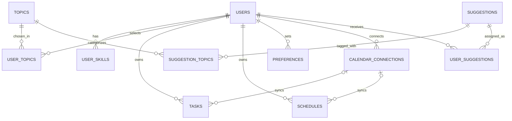

# Fuse - Overview

## 1. Vision

Build an AI-powered personal productivity assistant that combines an organizer, Google Calendar and Google Tasks integration, personalized recommendations, and a concise conversational interface.

**Core principle:** Conversations are temporary; useful outcomes (tasks, events, user-specific recommendation assignments, preferences) are saved.

## 2. Primary features

### Organizer
- Show **Tasks** and **Schedules/Events** in separate sections.
- Identify the current task or event, and show what is coming next when the user opens the app.
- Refresh connected Google information approximately every **30 minutes**; update the local interface immediately after actions inside the app.
- Support creating, editing, completing, and viewing items from the AI chat.
- Notify users about upcoming work/events, according to their preferences.

### AI chat
- Examples:
  - “Schedule a meeting on 12 August 2028 at 4 PM.”
  - “What event do I have tomorrow at 7 PM?”
  - “Suggest videos to improve my coding skills.”
- Keep answers brief and focused. Aim to finish simple interactions in 3–4 exchanges, with **Done** and **Continue Chatting** controls; don't enforce a rigid limit.
- Retain conversation context **only for the active session**; do not persist full chat transcripts in the application database.
- Confirm ambiguous or consequential calendar changes before writing them.

### Suggestions
- The **admin** regularly adds or refreshes YouTube videos in a standalone `suggestions` catalog, including video URL, thumbnail, description, duration, and active status.
- The admin controls a shared, **predefined `topics` catalog**; users select existing topics but cannot create new ones.
- Each video can belong to multiple topics via `suggestion_topics`; each user can select multiple topics via `user_topics`.
- At a scheduled time, a recommendation job matches available videos to users using selected topics, skills, preferences, feedback, and available time.
- Save each assignment in `user_suggestions`, not in the master catalog. Show current and historical assignments on the Suggestions page.
- Collect per-assignment feedback: **Interested / Not Interested / Not Rated**. Keep older assignments traceable; do not delete catalog videos during daily refreshes just to replace them.
- The current master catalog is **YouTube-video-specific**. Supporting blogs, games, and courses later would require broadening its fields/content model.

### Preferences & notifications
- Store explicit user preferences and reusable insights (e.g., short AI replies, preferred content types, notification settings, preferred learning time).
- Use a flexible `category + preference_key + preference_value` model.
- Support reminders and notifications as a separate application service/feature.

## 3. Suggested screens

| Screen | Purpose |
|---|---|
| Home | Current focus, next event/task, available free time, a relevant suggestion |
| Organizer | Separate task and event lists; |
| Suggestions | Current and historical recommendations; interest feedback |
| AI Chat | Short conversations, structured results, create/query actions |
| Settings/Profile | Selected topics, skills, preferences, notifications, Google connection |

UI cards can be color-coded: **blue for events**, **red for tasks**, **green for suggestions**. Colors are a frontend choice, not a database attribute.

## 4. Database model (Supabase / PostgreSQL)

### `users`
- `id` (UUID, PK; references `auth.users.id`)
- `name`, `email_id`, `created_at`

### `user_skills`
- `user_id` (FK to `users`)
- `skill` (text)
- Composite PK: (`user_id`, `skill`)

### `topics`
- `id` (UUID, PK), `name` (unique predefined topic), `created_at`
- Admin-managed master list of selectable topics, e.g. Python, AI, React.

### `user_topics`
- `user_id` (FK to `users`), `topic_id` (FK to `topics`)
- Composite PK: (`user_id`, `topic_id`)
- Links each user to any number of **predefined** topics; users cannot add rows to the master `topics` table.

`user_interests` is **not part of the intended final model**: it has been replaced conceptually by `user_topics`. If it still exists in Supabase, migrate any desired values and drop it separately. Composite keys prevent duplicate pairs without restricting each user to one topic/skill.

### `tasks`
- `id` (UUID, PK), `user_id` (FK)
- `title`, optional `description`
- `due_date` (DATE), `due_time` (TIME, nullable)
- `mark_completed` (BOOLEAN)
- `google_connection_id` (nullable FK to connected Google account)
- `google_task_id` (nullable Google task ID)
- **Recommended addition:** `google_tasklist_id` (Google task-list ID, currently absent from the reported table)
- `sync_status` (`pending` / `synced` / `error`)
- `created_at`, `updated_at`

**Important:** A task's due date/time is a **deadline**, not necessarily its planned start time. Google Tasks' public API does not reliably retain the time-of-day in its `due` field. Store exact local due time in Supabase; do not promise it will round-trip through Google Tasks.

### `schedules`
- `id` (UUID, PK), `user_id` (FK)
- `title`, optional `description`
- `valid_from`, `valid_to` (timezone-aware timestamps)
- `mark_completed` (app-defined flag)
- `google_connection_id` (nullable FK)
- `cal_event_id` (Google Calendar event ID)
- `sync_status`, `created_at`, `updated_at`
- Optional later: `task_id` if scheduling a focused work block for an existing task

### `suggestions` (admin-owned master video catalog)
- `id` (UUID, PK)
- `title`, `youtube_video_id` (unique), `video_url`, `thumbnail_url`, `description`
- `duration_minutes` (nullable), `created_at`, `updated_at`, `is_active`
- **No `user_id`, no `is_interested`**: a video can be reused for different users.

### `suggestion_topics`
- `suggestion_id` (FK to `suggestions`), `topic_id` (FK to `topics`)
- Composite PK: (`suggestion_id`, `topic_id`)
- Many-to-many tagging: each suggestion can have multiple predefined topics, and each topic can label multiple suggestions.
- Business rule: **every suggestion must have at least one topic**. The junction table alone does not enforce that; enforce in the admin ingestion transaction or a trigger.

### `user_suggestions`
- `id` (UUID, PK), `user_id` (FK to `users`), `suggestion_id` (FK to `suggestions`)
- `recommended_at` (timestamp), `is_interested` (nullable BOOLEAN), `feedback_at` (nullable timestamp)
- Records each recommendation event for history and feedback. A user can receive many videos; one video can be sent to many users. Repeat assignments can be recorded on different occasions.
- Do not delete videos that are referenced by historical assignments. Deactivate stale videos with `is_active = false` instead.

### `calendar_connections`
- `id` (UUID, PK), `user_id` (FK)
- `google_account_id` (stable Google identity), `google_acc` (display email)
- `google_calendar_id` (selected calendar; `primary` for default)
- `connection_status`, `calendar_sync_token`
- `last_calendar_sync_at`, `last_tasks_sync_at`, `created_at`
- Store refresh tokens **only in a restricted backend-only location**, encrypted with a key stored separately, never exposed to frontend clients.

For multiple Google calendars per account, later split account credentials from individual connected-calendar records.

### `preferences`
- `id` (UUID, PK), `user_id` (FK)
- `category` (`suggestion`, `task`, `schedule`, `ai_response`, `general`)
- `preference_key` (text), `preference_value` (JSONB)
- `created_at`, `updated_at`
- Unique (`user_id`, `category`, `preference_key`)

Example: `category=ai_response`, `preference_key=response_length`, `preference_value="short"`.

**There is no persistent Chat History table.** Temporary in-memory session context is sufficient for clarification turns. `Done / Continue` is session state, not necessarily feedback.

## 5. High-level relationships



**Topic matching:** `users` → `user_topics` → `topics` ← `suggestion_topics` ← `suggestions`.

**Traceability:** `users` → `user_suggestions` ← `suggestions`. The master catalog stays user-independent, while every delivered recommendation has a user-specific record and optional feedback.

**No `user_interests` or `legacy_suggestions` in the intended final database.** The app has 11 intended public tables: `users`, `user_skills`, `topics`, `user_topics`, `tasks`, `schedules`, `calendar_connections`, `suggestions`, `suggestion_topics`, `user_suggestions`, and `preferences`. OAuth credentials additionally live in a private, backend-only table.

## 6. Google integration

| Local entity | External service | Key identifiers |
|---|---|---|
| Schedule | Google Calendar API | Calendar ID + event ID |
| Task | Google Tasks API | task-list ID + task ID (add missing task-list field) |

Google Calendar's interface can display dated Google Tasks, but the **Calendar Events API and Google Tasks API are separate**.

**Sync flow:**
1. User authorizes Google OAuth with required calendar/tasks scopes.
2. Backend saves protected credentials and connection metadata.
3. Initial import fetches calendar events and tasks; map Google IDs to local IDs.
4. Every ~30 minutes (and when suitable on app open), fetch changes from Google. Google Calendar supports incremental sync tokens; tasks require their own sync logic.
5. When an item changes inside the organizer, update the local UI immediately and synchronize it to Google through a backend job.
6. Handle retries, duplicates, deletions, disconnected accounts, and conflicting edits explicitly.

**Note:** Supabase tables alone do not implement sync; backend workers/Edge Functions and scheduled jobs are required.

## 7. AI and frontend response architecture

Prefer **tool/function calling** for actions, and **validated structured JSON** for presentation:

```text
User request
   ↓
AI classifies intent (query / create / update / recommend)
   ↓
Backend checks permissions, validates parameters,
queries the database / calls Google or content-search services
   ↓
Structured response with typed display blocks
   ↓
Frontend renders ScheduleCard, TaskCard, SuggestionCard, or text
```

Example *illustrative* JSON response:

```json
{
  "message": "Here is your plan for tomorrow.",
  "blocks": [
    {
      "type": "schedule",
      "data": {
        "id": "event-123",
        "title": "Project meeting",
        "start": "2026-10-14T10:00:00+05:30",
        "end": "2026-10-14T11:00:00+05:30"
      }
    },
    {
      "type": "task",
      "data": {
        "id": "task-456",
        "title": "Finish assignment",
        "due_date": "2026-10-14",
        "due_time": "17:00:00",
        "is_completed": false
      }
    }
  ]
}
```

The frontend—not the LLM—controls colors, component layout, and user interactions. Do not trust AI-generated IDs, dates, or URLs without backend validation.

## 8. Suggested MVP implementation order

1. **Authentication & data model:** Supabase Auth, users, normalized skills, predefined topics, user-topic selections, RLS policies.
2. **Organizer:** current/next activity logic.
3. **Google connection & synchronization:** OAuth, Google Calendar + Google Tasks imports and updates, retry/error handling.
4. **AI chat:** Read schedule & tasks, delete schedule & tasks, create events/tasks with confirmation, use typed response JSON, temporary session context.
5. **Suggestions:** Admin video ingestion and topic tagging, scheduled per-user matching, `user_suggestions` history and feedback.
6. **Notifications & personalization:** Reminders, preferred content types, feedback-aware ranking.
7. **Polish:** Conflict resolution, recurring calendar events, performance, better time-aware recommendations.

## 9. Decisions to revisit

- Whether task due time is merely a local deadline or should produce a separate Google Calendar event for a scheduled work block.
- Whether to support multiple Google accounts/calendars and multiple Google task lists at launch.
- Recommendation cadence and whether to prevent repeated assignments of the same video within a daily batch.
- How to resolve edits made simultaneously in Google and your app.
- How to handle permissions, expiration, privacy, and retention for external AI and recommendation services.

## 10. Project summary

The assistant is **an action-oriented productivity app rather than a persistent chatbot**. Its organizer shows tasks and scheduled events; Google APIs keep supported items synchronized; the AI interprets short natural-language requests and returns validated, typed UI data; and an admin-managed video catalog plus traceable user-specific suggestions and preferences improve recommendations over time, without storing complete chat histories.