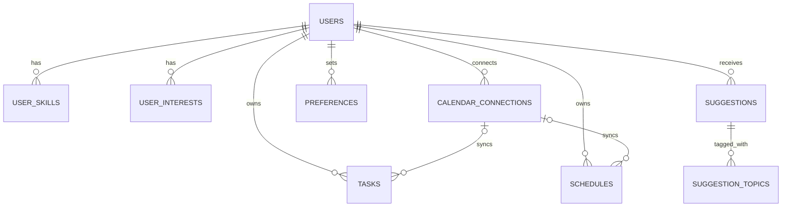

# Fuse - Overview

## 1. Vision

Build an AI-powered personal productivity assistant that combines an organizer, Google Calendar and Google Tasks integration, personalized recommendations, and a concise conversational interface.

**Core principle:** Conversations are temporary; useful outcomes (tasks, events, suggestions, preferences) are saved.

## 2. Primary features

### Organizer
- Show **Tasks** and **Schedules/Events** in separate sections.
- Identify the current task or event, and show what is coming next when the user opens the app.
- Refresh connected Google information approximately every **30 minutes**; update the local interface immediately after actions inside the app.
- Support creating, editing, completing, and viewing items from the AI chat.
- Notify users about upcoming work/events, according to their preferences.

### AI chat
- Examples:
  - “Schedule a meeting on 12 August 2028 at 4 PM.”
  - “What event do I have tomorrow at 7 PM?”
  - “Suggest videos to improve my coding skills.”
- Keep answers brief and focused. Aim to finish simple interactions in 3–4 exchanges, with **Done** and **Continue Chatting** controls; don't enforce a rigid limit.
- Retain conversation context **only for the active session**; do not persist full chat transcripts in the application database.
- Confirm ambiguous or consequential calendar changes before writing them.

### Suggestions
- Suggest videos, blogs, games, courses, or other resources based on **interests, skills, available time, and preferences**.
- Display new and previous suggestions on a dedicated page.
- Store recommendation metadata (title, link, content type, topics, summary, estimated duration, generation time).
- Collect per-suggestion feedback: **Interested / Not Interested / Not Rated**.
- Consider feedback when improving later recommendations without inferring too much from a single click.

### Preferences & notifications
- Store explicit user preferences and reusable insights (e.g., short AI replies, preferred content types, notification settings, preferred learning time).
- Use a flexible `category + preference_key + preference_value` model.
- Support reminders and notifications as a separate application service/feature.

## 3. Suggested screens

| Screen | Purpose |
|---|---|
| Home | Current focus, next event/task, available free time, a relevant suggestion |
| Organizer | Separate task and event lists; |
| Suggestions | Current and historical recommendations; interest feedback |
| AI Chat | Short conversations, structured results, create/query actions |
| Settings/Profile | Interests, skills, preferences, notifications, Google connection |

UI cards can be color-coded: **blue for events**, **red for tasks**, **green for suggestions**. Colors are a frontend choice, not a database attribute.

## 4. Database model (Supabase / PostgreSQL)

### `users`
- `id` (UUID, PK; references `auth.users.id`)
- `name`, `email_id`, `created_at`

### `user_skills`
- `user_id` (FK to `users`)
- `skill` (text)
- Composite PK: (`user_id`, `skill`)

### `user_interests`
- `user_id` (FK to `users`)
- `interest` (text)
- Composite PK: (`user_id`, `interest`)

Separating skills and interests into rows supports conventional 1NF normalization. A composite key **does allow** the same user to have multiple different skills/interests; it only prevents duplicate pairs.

### `tasks`
- `id` (UUID, PK), `user_id` (FK)
- `title`, optional `description`
- `due_date` (DATE), `due_time` (TIME, nullable)
- `mark_completed` (BOOLEAN)
- `google_connection_id` (nullable FK to connected Google account)
- `google_task_id`,(nullable external IDs)
- `sync_status` (`pending` / `synced` / `error`)
- `created_at`, `updated_at`

**Important:** A task's due date/time is a **deadline**, not necessarily its planned start time. Google Tasks' public API does not reliably retain the time-of-day in its `due` field. Store exact local due time in Supabase; do not promise it will round-trip through Google Tasks.

### `schedules`
- `id` (UUID, PK), `user_id` (FK)
- `title`, optional `description`
- `valid_from`, `valid_to` (timezone-aware timestamps)
- `mark_completed` (app-defined flag)
- `google_connection_id` (nullable FK)
- `cal_event_id` (Google Calendar event ID)
- `sync_status`, `created_at`, `updated_at`
- Optional later: `task_id` if scheduling a focused work block for an existing task

### `suggestions`
- `id` (UUID, PK), `user_id` (FK)
- `title`, `content_type`, `link`, `summary`
- `estimated_duration` (minutes)
- `is_interested` (nullable BOOLEAN: null = unrated)
- `valid_from`, `valid_to` (nullable; only when recommendation has a useful validity window)
- `created_at`
- `suggestion_topics(suggestion_id, topic)` as a separate table if strictly normalizing multi-topic suggestions; otherwise a PostgreSQL text array is a practical MVP option.

### `calendar_connections`
- `id` (UUID, PK), `user_id` (FK)
- `google_account_id` (stable Google identity), `google_acc` (display email)
- `google_calendar_id` (selected calendar; `primary` for default)
- `connection_status`, `calendar_sync_token`
- `last_calendar_sync_at`, `last_tasks_sync_at`, `created_at`
- Store refresh tokens **only in a restricted backend-only location**, encrypted with a key stored separately, never exposed to frontend clients.

For multiple Google calendars per account, later split account credentials from individual connected-calendar records.

### `preferences`
- `id` (UUID, PK), `user_id` (FK)
- `category` (`suggestion`, `task`, `schedule`, `ai_response`, `general`)
- `preference_key` (text), `preference_value` (JSONB)
- `created_at`, `updated_at`
- Unique (`user_id`, `category`, `preference_key`)

Example: `category=ai_response`, `preference_key=response_length`, `preference_value="short"`.

**There is no persistent Chat History table.** Temporary in-memory session context is sufficient for clarification turns. `Done / Continue` is session state, not necessarily feedback.

## 5. High-level relationships



Suggestions are linked directly to the **user**; the recommendation engine retrieves skills and interests using `user_id`. Direct suggestion-to-skill joins are unnecessary unless you want to record why each specific recommendation was generated.

## 6. Google integration

| Local entity | External service | Key identifiers |
|---|---|---|
| Schedule | Google Calendar API | Calendar ID + event ID |
| Task | Google Tasks API | task ID |

Google Calendar's interface can display dated Google Tasks, but the **Calendar Events API and Google Tasks API are separate**.

**Sync flow:**
1. User authorizes Google OAuth with required calendar/tasks scopes.
2. Backend saves protected credentials and connection metadata.
3. Initial import fetches calendar events and tasks; map Google IDs to local IDs.
4. Every ~30 minutes (and when suitable on app open), fetch changes from Google. Google Calendar supports incremental sync tokens; tasks require their own sync logic.
5. When an item changes inside the organizer, update the local UI immediately and synchronize it to Google through a backend job.
6. Handle retries, duplicates, deletions, disconnected accounts, and conflicting edits explicitly.

**Note:** Supabase tables alone do not implement sync; backend workers/Edge Functions and scheduled jobs are required.

## 7. AI and frontend response architecture

Prefer **tool/function calling** for actions, and **validated structured JSON** for presentation:

```text
User request
   ↓
AI classifies intent (query / create / update / recommend)
   ↓
Backend checks permissions, validates parameters,
queries the database / calls Google or content-search services
   ↓
Structured response with typed display blocks
   ↓
Frontend renders ScheduleCard, TaskCard, SuggestionCard, or text
```

Example *illustrative* JSON response:

```json
{
  "message": "Here is your plan for tomorrow.",
  "blocks": [
    {
      "type": "schedule",
      "data": {
        "id": "event-123",
        "title": "Project meeting",
        "start": "2026-10-14T10:00:00+05:30",
        "end": "2026-10-14T11:00:00+05:30"
      }
    },
    {
      "type": "task",
      "data": {
        "id": "task-456",
        "title": "Finish assignment",
        "due_date": "2026-10-14",
        "due_time": "17:00:00",
        "is_completed": false
      }
    }
  ]
}
```

The frontend—not the LLM—controls colors, component layout, and user interactions. Do not trust AI-generated IDs, dates, or URLs without backend validation.

## 8. Suggested MVP implementation order

1. **Authentication & data model:** Supabase Auth, users, normalized skills/interests, RLS policies.
2. **Organizer:** current/next activity logic.
3. **Google connection & synchronization:** OAuth, Google Calendar + Google Tasks imports and updates, retry/error handling.
4. **AI chat:** Read schedule & tasks, delete schedule & tasks, create events/tasks with confirmation, use typed response JSON, temporary session context.
5. **Suggestions:** Retrieve real resources, store links and summaries, feedback, suggestions history.
6. **Notifications & personalization:** Reminders, preferred content types, feedback-aware ranking.
7. **Polish:** Conflict resolution, recurring calendar events, performance, better time-aware recommendations.

## 9. Decisions to revisit

- Whether task due time is merely a local deadline or should produce a separate Google Calendar event for a scheduled work block.
- Whether to support multiple Google accounts/calendars and multiple Google task lists at launch.
- Whether suggestions have real validity windows or simply creation/history timestamps.
- How to resolve edits made simultaneously in Google and your app.
- How to handle permissions, expiration, privacy, and retention for external AI and recommendation services.

## 10. Project summary

The assistant is **an action-oriented productivity app rather than a persistent chatbot**. Its organizer shows tasks and scheduled events; Google APIs keep supported items synchronized; the AI interprets short natural-language requests and returns validated, typed UI data; and saved suggestions/preferences improve recommendations over time, without storing complete chat histories.